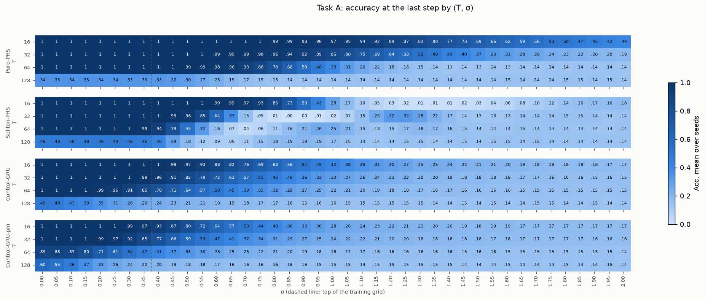
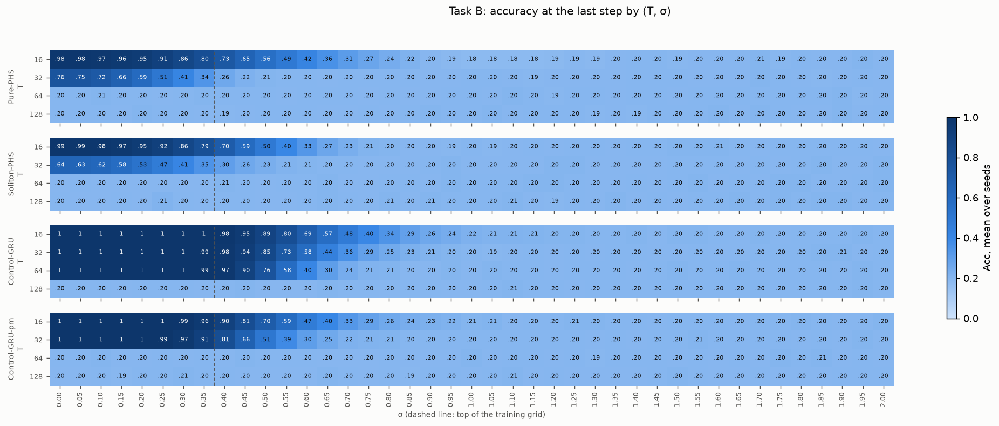
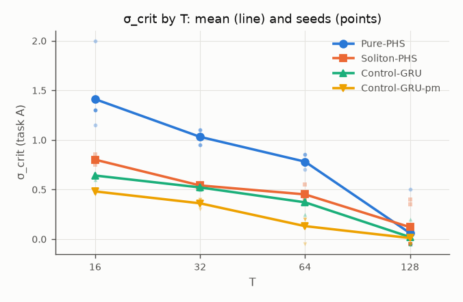
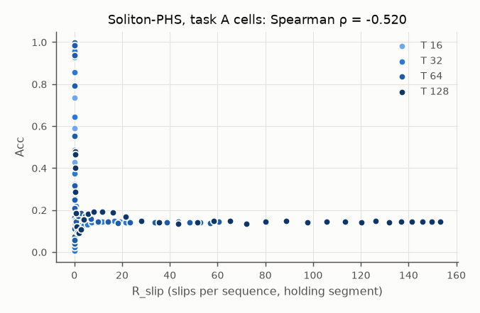

# Results

> Generated from `results/results.json` by `tools/render_results.py`. PREREG `prereg-v1` (prereg.json SHA-256 `8cdffc90c408d047…`), `analyze.py` SHA-256 `227f952d175fbee3…`.

## Verdict: `INCONCLUSIVE`

neither confirmation nor refutation; a new PREREG with more seeds is the remedy.

Runs: 160 of 160 with a manifest; FAILED: 0; missing: 0.

## Hypotheses

| flag | metric | Soliton vs | delta (mean) | min effect | p (exact, one-sided) | Holm | holds |
|---|---|---|---|---|---|---|---|
| A1 | sigma_crit_mean | Pure-PHS | -0.3425 | 0.05 | 1.0000 | False | **False** |
| A2 | lambda | Pure-PHS | 0.0412 | 0.02 | 0.5000 | False | **False** |
| G1 | sigma_crit_mean | Control-GRU | 0.0900 | 0.05 | 0.0119 | True | **True** |
| G2 | lambda | Control-GRU | 0.0150 | 0.02 | 0.3452 | False | **False** |

- **B** (Soliton not worse than Pure on task B, mean Acc over T at sigma 0, margin 0.05): Soliton 0.5079, Pure 0.5365, delta -0.0285 → **True**
- **V** (gate and Acc ≥ 0.95 on A at T = 16, sigma 0 in ≥ 4 of 5 seeds): gate True; Control-GRU 5/5; Pure-PHS 5/5; Soliton-PHS 5/5 → **True**
- **room** (REFUTED needs Pure-PHS mean sigma_crit ≤ 1.95 or mean lambda ≤ -0.02): Pure sigma_crit 0.8200 (room True), lambda -0.1965 (room True) → **True**

## Per seed

| model | seed | mean sigma_crit (A) | sigma_crit at T = 16, 32, 64, 128 | lambda (A, sigma 0.10) | Acc A T=16 sigma 0 | mean Acc B sigma 0 |
|---|---|---|---|---|---|---|
| Control-GRU | 0 | 0.4000 | 0.65, 0.50, 0.40, 0.05 | -0.0754 | 1.0000 | 0.7995 |
| Control-GRU | 1 | 0.3750 | 0.65, 0.50, 0.40, -0.05 | -0.2585 | 1.0000 | 0.7993 |
| Control-GRU | 2 | 0.3750 | 0.65, 0.50, 0.40, -0.05 | -0.2572 | 1.0000 | 0.8004 |
| Control-GRU | 3 | 0.3500 | 0.65, 0.55, 0.25, -0.05 | -0.2599 | 1.0000 | 0.8016 |
| Control-GRU | 4 | 0.4375 | 0.60, 0.55, 0.40, 0.20 | -0.0004 | 1.0000 | 0.8009 |
| Control-GRU-pm | 0 | 0.2000 | 0.50, 0.40, -0.05, -0.05 | -0.3127 | 1.0000 | 0.5990 |
| Control-GRU-pm | 1 | 0.2750 | 0.50, 0.35, 0.15, 0.10 | -0.0500 | 1.0000 | 0.6022 |
| Control-GRU-pm | 2 | 0.2500 | 0.50, 0.40, 0.15, -0.05 | -0.2122 | 1.0000 | 0.5997 |
| Control-GRU-pm | 3 | 0.2375 | 0.45, 0.35, 0.20, -0.05 | -0.2560 | 1.0000 | 0.6019 |
| Control-GRU-pm | 4 | 0.2625 | 0.45, 0.30, 0.20, 0.10 | -0.0396 | 1.0000 | 0.5952 |
| Pure-PHS | 0 | 0.8000 | 1.30, 1.10, 0.85, -0.05 | -0.2448 | 1.0000 | 0.5511 |
| Pure-PHS | 1 | 0.9000 | 1.30, 1.05, 0.75, 0.50 | 0.0000 | 1.0000 | 0.5859 |
| Pure-PHS | 2 | 0.7625 | 1.15, 1.10, 0.85, -0.05 | -0.2429 | 1.0000 | 0.5797 |
| Pure-PHS | 3 | 0.9000 | 2.00, 0.95, 0.70, -0.05 | -0.2462 | 1.0000 | 0.5652 |
| Pure-PHS | 4 | 0.7375 | 1.30, 0.95, 0.75, -0.05 | -0.2487 | 1.0000 | 0.4004 |
| Soliton-PHS | 0 | 0.5375 | 0.85, 0.55, 0.40, 0.35 | -0.0072 | 1.0000 | 0.5712 |
| Soliton-PHS | 1 | 0.4125 | 0.75, 0.55, 0.40, -0.05 | -0.2558 | 1.0000 | 0.3956 |
| Soliton-PHS | 2 | 0.5500 | 0.80, 0.55, 0.45, 0.40 | -0.0002 | 1.0000 | 0.3998 |
| Soliton-PHS | 3 | 0.4500 | 0.80, 0.50, 0.55, -0.05 | -0.2571 | 1.0000 | 0.5891 |
| Soliton-PHS | 4 | 0.4375 | 0.80, 0.55, 0.45, -0.05 | -0.2561 | 1.0000 | 0.5840 |

## Accuracy by cell, task A (mean over seeds)

| model | T | 0.00 | 0.05 | 0.10 | 0.15 | 0.20 | 0.25 | 0.30 | 0.35 | 0.40 | 0.45 | 0.50 | 0.55 | 0.60 | 0.65 | 0.70 | 0.75 | 0.80 | 0.85 | 0.90 | 0.95 | 1.00 | 1.05 | 1.10 | 1.15 | 1.20 | 1.25 | 1.30 | 1.35 | 1.40 | 1.45 | 1.50 | 1.55 | 1.60 | 1.65 | 1.70 | 1.75 | 1.80 | 1.85 | 1.90 | 1.95 | 2.00 |
|---|---|---|---|---|---|---|---|---|---|---|---|---|---|---|---|---|---|---|---|---|---|---|---|---|---|---|---|---|---|---|---|---|---|---|---|---|---|---|---|---|---|---|
| Pure-PHS | 16 | 1.000 | 1.000 | 1.000 | 1.000 | 1.000 | 1.000 | 1.000 | 1.000 | 1.000 | 1.000 | 1.000 | 1.000 | 0.999 | 0.998 | 0.998 | 0.996 | 0.994 | 0.990 | 0.985 | 0.979 | 0.967 | 0.955 | 0.938 | 0.919 | 0.891 | 0.865 | 0.833 | 0.797 | 0.769 | 0.730 | 0.690 | 0.657 | 0.623 | 0.589 | 0.560 | 0.526 | 0.497 | 0.470 | 0.452 | 0.425 | 0.402 |
| Pure-PHS | 32 | 1.000 | 1.000 | 1.000 | 1.000 | 1.000 | 1.000 | 1.000 | 1.000 | 1.000 | 0.999 | 0.998 | 0.998 | 0.995 | 0.993 | 0.988 | 0.979 | 0.963 | 0.944 | 0.919 | 0.887 | 0.848 | 0.804 | 0.747 | 0.694 | 0.642 | 0.582 | 0.534 | 0.489 | 0.434 | 0.404 | 0.368 | 0.333 | 0.311 | 0.280 | 0.264 | 0.242 | 0.227 | 0.222 | 0.205 | 0.195 | 0.187 |
| Pure-PHS | 64 | 1.000 | 1.000 | 1.000 | 1.000 | 1.000 | 1.000 | 1.000 | 1.000 | 0.999 | 0.998 | 0.995 | 0.990 | 0.980 | 0.957 | 0.925 | 0.860 | 0.778 | 0.685 | 0.577 | 0.481 | 0.392 | 0.314 | 0.260 | 0.216 | 0.184 | 0.164 | 0.150 | 0.142 | 0.132 | 0.137 | 0.133 | 0.138 | 0.135 | 0.138 | 0.139 | 0.142 | 0.137 | 0.142 | 0.139 | 0.142 | 0.140 |
| Pure-PHS | 128 | 0.345 | 0.345 | 0.345 | 0.346 | 0.341 | 0.339 | 0.332 | 0.331 | 0.325 | 0.315 | 0.297 | 0.269 | 0.233 | 0.193 | 0.170 | 0.153 | 0.146 | 0.142 | 0.144 | 0.139 | 0.140 | 0.141 | 0.142 | 0.142 | 0.142 | 0.141 | 0.142 | 0.144 | 0.145 | 0.137 | 0.141 | 0.141 | 0.145 | 0.143 | 0.140 | 0.141 | 0.147 | 0.145 | 0.145 | 0.146 | 0.137 |
| Soliton-PHS | 16 | 1.000 | 1.000 | 1.000 | 1.000 | 1.000 | 1.000 | 1.000 | 1.000 | 1.000 | 1.000 | 0.999 | 0.998 | 0.994 | 0.986 | 0.968 | 0.927 | 0.855 | 0.734 | 0.588 | 0.428 | 0.281 | 0.171 | 0.096 | 0.052 | 0.027 | 0.015 | 0.010 | 0.009 | 0.010 | 0.017 | 0.025 | 0.040 | 0.059 | 0.083 | 0.099 | 0.121 | 0.144 | 0.156 | 0.167 | 0.164 | 0.178 |
| Soliton-PHS | 32 | 1.000 | 1.000 | 1.000 | 1.000 | 1.000 | 1.000 | 1.000 | 0.999 | 0.998 | 0.991 | 0.957 | 0.855 | 0.644 | 0.374 | 0.154 | 0.047 | 0.011 | 0.003 | 0.002 | 0.007 | 0.025 | 0.071 | 0.155 | 0.247 | 0.318 | 0.324 | 0.282 | 0.217 | 0.171 | 0.141 | 0.128 | 0.127 | 0.132 | 0.142 | 0.143 | 0.145 | 0.147 | 0.146 | 0.145 | 0.140 | 0.142 |
| Soliton-PHS | 64 | 0.996 | 0.996 | 0.998 | 0.998 | 0.999 | 0.999 | 0.997 | 0.985 | 0.937 | 0.794 | 0.551 | 0.318 | 0.158 | 0.074 | 0.039 | 0.058 | 0.111 | 0.164 | 0.209 | 0.256 | 0.250 | 0.209 | 0.152 | 0.134 | 0.145 | 0.171 | 0.185 | 0.172 | 0.158 | 0.146 | 0.144 | 0.139 | 0.140 | 0.146 | 0.142 | 0.141 | 0.144 | 0.141 | 0.140 | 0.138 | 0.144 |
| Soliton-PHS | 128 | 0.478 | 0.478 | 0.483 | 0.481 | 0.486 | 0.486 | 0.479 | 0.464 | 0.402 | 0.287 | 0.185 | 0.119 | 0.094 | 0.091 | 0.107 | 0.154 | 0.183 | 0.191 | 0.193 | 0.188 | 0.168 | 0.149 | 0.141 | 0.135 | 0.142 | 0.148 | 0.147 | 0.136 | 0.143 | 0.147 | 0.142 | 0.146 | 0.145 | 0.141 | 0.148 | 0.141 | 0.143 | 0.144 | 0.144 | 0.144 | 0.143 |
| Control-GRU | 16 | 1.000 | 1.000 | 1.000 | 1.000 | 1.000 | 1.000 | 1.000 | 0.999 | 0.996 | 0.987 | 0.965 | 0.928 | 0.884 | 0.820 | 0.761 | 0.693 | 0.628 | 0.564 | 0.509 | 0.455 | 0.417 | 0.378 | 0.347 | 0.319 | 0.298 | 0.274 | 0.253 | 0.249 | 0.235 | 0.220 | 0.210 | 0.206 | 0.200 | 0.193 | 0.183 | 0.179 | 0.177 | 0.178 | 0.176 | 0.175 | 0.165 |
| Control-GRU | 32 | 1.000 | 1.000 | 1.000 | 1.000 | 1.000 | 0.999 | 0.997 | 0.985 | 0.958 | 0.914 | 0.852 | 0.788 | 0.720 | 0.635 | 0.569 | 0.508 | 0.453 | 0.396 | 0.365 | 0.326 | 0.302 | 0.272 | 0.255 | 0.237 | 0.228 | 0.215 | 0.200 | 0.195 | 0.188 | 0.183 | 0.182 | 0.176 | 0.164 | 0.165 | 0.166 | 0.162 | 0.160 | 0.157 | 0.153 | 0.155 | 0.154 |
| Control-GRU | 64 | 1.000 | 1.000 | 1.000 | 0.999 | 0.988 | 0.960 | 0.914 | 0.854 | 0.783 | 0.708 | 0.636 | 0.572 | 0.504 | 0.448 | 0.393 | 0.352 | 0.317 | 0.286 | 0.265 | 0.251 | 0.222 | 0.212 | 0.201 | 0.193 | 0.183 | 0.179 | 0.174 | 0.164 | 0.168 | 0.162 | 0.162 | 0.155 | 0.155 | 0.151 | 0.153 | 0.150 | 0.153 | 0.147 | 0.152 | 0.147 | 0.154 |
| Control-GRU | 128 | 0.486 | 0.478 | 0.432 | 0.389 | 0.349 | 0.309 | 0.284 | 0.260 | 0.241 | 0.227 | 0.211 | 0.205 | 0.193 | 0.187 | 0.181 | 0.174 | 0.166 | 0.162 | 0.155 | 0.159 | 0.156 | 0.151 | 0.152 | 0.150 | 0.149 | 0.149 | 0.146 | 0.143 | 0.142 | 0.148 | 0.142 | 0.149 | 0.144 | 0.143 | 0.145 | 0.147 | 0.144 | 0.142 | 0.149 | 0.140 | 0.142 |
| Control-GRU-pm | 16 | 1.000 | 1.000 | 1.000 | 1.000 | 1.000 | 0.998 | 0.989 | 0.967 | 0.928 | 0.872 | 0.802 | 0.720 | 0.639 | 0.569 | 0.503 | 0.439 | 0.395 | 0.357 | 0.330 | 0.303 | 0.276 | 0.256 | 0.243 | 0.230 | 0.224 | 0.209 | 0.208 | 0.203 | 0.197 | 0.189 | 0.183 | 0.186 | 0.189 | 0.175 | 0.172 | 0.172 | 0.174 | 0.170 | 0.168 | 0.169 | 0.166 |
| Control-GRU-pm | 32 | 1.000 | 1.000 | 1.000 | 0.999 | 0.994 | 0.972 | 0.921 | 0.850 | 0.773 | 0.681 | 0.593 | 0.525 | 0.467 | 0.413 | 0.369 | 0.340 | 0.306 | 0.287 | 0.269 | 0.249 | 0.243 | 0.225 | 0.216 | 0.209 | 0.203 | 0.196 | 0.185 | 0.184 | 0.184 | 0.181 | 0.180 | 0.174 | 0.176 | 0.169 | 0.169 | 0.166 | 0.166 | 0.168 | 0.162 | 0.162 | 0.165 |
| Control-GRU-pm | 64 | 0.889 | 0.885 | 0.867 | 0.803 | 0.706 | 0.612 | 0.536 | 0.467 | 0.407 | 0.365 | 0.330 | 0.301 | 0.278 | 0.253 | 0.233 | 0.222 | 0.205 | 0.196 | 0.191 | 0.180 | 0.176 | 0.173 | 0.172 | 0.164 | 0.163 | 0.159 | 0.159 | 0.156 | 0.161 | 0.154 | 0.157 | 0.157 | 0.152 | 0.147 | 0.150 | 0.148 | 0.151 | 0.147 | 0.146 | 0.148 | 0.144 |
| Control-GRU-pm | 128 | 0.595 | 0.553 | 0.464 | 0.369 | 0.307 | 0.263 | 0.235 | 0.217 | 0.204 | 0.189 | 0.183 | 0.177 | 0.174 | 0.161 | 0.161 | 0.155 | 0.158 | 0.157 | 0.156 | 0.148 | 0.149 | 0.150 | 0.143 | 0.148 | 0.151 | 0.145 | 0.149 | 0.145 | 0.145 | 0.145 | 0.143 | 0.141 | 0.145 | 0.142 | 0.145 | 0.141 | 0.147 | 0.141 | 0.143 | 0.146 | 0.141 |

## Accuracy by cell, task B (mean over seeds)

| model | T | 0.00 | 0.05 | 0.10 | 0.15 | 0.20 | 0.25 | 0.30 | 0.35 | 0.40 | 0.45 | 0.50 | 0.55 | 0.60 | 0.65 | 0.70 | 0.75 | 0.80 | 0.85 | 0.90 | 0.95 | 1.00 | 1.05 | 1.10 | 1.15 | 1.20 | 1.25 | 1.30 | 1.35 | 1.40 | 1.45 | 1.50 | 1.55 | 1.60 | 1.65 | 1.70 | 1.75 | 1.80 | 1.85 | 1.90 | 1.95 | 2.00 |
|---|---|---|---|---|---|---|---|---|---|---|---|---|---|---|---|---|---|---|---|---|---|---|---|---|---|---|---|---|---|---|---|---|---|---|---|---|---|---|---|---|---|---|
| Pure-PHS | 16 | 0.983 | 0.981 | 0.975 | 0.964 | 0.946 | 0.912 | 0.862 | 0.805 | 0.730 | 0.646 | 0.565 | 0.491 | 0.420 | 0.356 | 0.312 | 0.270 | 0.240 | 0.216 | 0.199 | 0.189 | 0.181 | 0.183 | 0.182 | 0.181 | 0.185 | 0.192 | 0.190 | 0.198 | 0.200 | 0.199 | 0.194 | 0.199 | 0.198 | 0.197 | 0.206 | 0.192 | 0.201 | 0.196 | 0.198 | 0.203 | 0.198 |
| Pure-PHS | 32 | 0.759 | 0.747 | 0.719 | 0.661 | 0.594 | 0.506 | 0.412 | 0.337 | 0.262 | 0.222 | 0.206 | 0.201 | 0.200 | 0.199 | 0.201 | 0.203 | 0.202 | 0.200 | 0.199 | 0.198 | 0.201 | 0.200 | 0.198 | 0.195 | 0.199 | 0.199 | 0.195 | 0.195 | 0.201 | 0.202 | 0.200 | 0.199 | 0.198 | 0.199 | 0.205 | 0.202 | 0.196 | 0.195 | 0.198 | 0.201 | 0.196 |
| Pure-PHS | 64 | 0.203 | 0.199 | 0.206 | 0.202 | 0.201 | 0.199 | 0.200 | 0.204 | 0.201 | 0.202 | 0.202 | 0.198 | 0.201 | 0.201 | 0.201 | 0.197 | 0.202 | 0.198 | 0.197 | 0.201 | 0.202 | 0.199 | 0.203 | 0.200 | 0.193 | 0.201 | 0.199 | 0.198 | 0.200 | 0.202 | 0.196 | 0.201 | 0.201 | 0.201 | 0.200 | 0.200 | 0.202 | 0.200 | 0.204 | 0.195 | 0.197 |
| Pure-PHS | 128 | 0.201 | 0.201 | 0.201 | 0.197 | 0.205 | 0.199 | 0.201 | 0.199 | 0.195 | 0.197 | 0.200 | 0.203 | 0.201 | 0.197 | 0.199 | 0.200 | 0.197 | 0.200 | 0.203 | 0.202 | 0.202 | 0.205 | 0.197 | 0.202 | 0.203 | 0.199 | 0.194 | 0.197 | 0.195 | 0.199 | 0.199 | 0.202 | 0.203 | 0.199 | 0.204 | 0.201 | 0.199 | 0.198 | 0.204 | 0.198 | 0.201 |
| Soliton-PHS | 16 | 0.989 | 0.986 | 0.982 | 0.971 | 0.949 | 0.915 | 0.859 | 0.789 | 0.698 | 0.593 | 0.495 | 0.402 | 0.330 | 0.269 | 0.231 | 0.207 | 0.204 | 0.199 | 0.197 | 0.195 | 0.201 | 0.194 | 0.199 | 0.201 | 0.199 | 0.202 | 0.200 | 0.199 | 0.200 | 0.203 | 0.204 | 0.204 | 0.205 | 0.200 | 0.197 | 0.202 | 0.203 | 0.200 | 0.199 | 0.199 | 0.198 |
| Soliton-PHS | 32 | 0.645 | 0.633 | 0.616 | 0.581 | 0.534 | 0.474 | 0.407 | 0.347 | 0.298 | 0.258 | 0.234 | 0.212 | 0.206 | 0.200 | 0.202 | 0.199 | 0.199 | 0.198 | 0.199 | 0.205 | 0.196 | 0.197 | 0.198 | 0.195 | 0.204 | 0.204 | 0.196 | 0.199 | 0.198 | 0.198 | 0.200 | 0.201 | 0.201 | 0.198 | 0.202 | 0.199 | 0.199 | 0.205 | 0.197 | 0.198 | 0.204 |
| Soliton-PHS | 64 | 0.197 | 0.201 | 0.197 | 0.199 | 0.199 | 0.197 | 0.198 | 0.198 | 0.205 | 0.200 | 0.196 | 0.200 | 0.200 | 0.204 | 0.195 | 0.197 | 0.200 | 0.200 | 0.198 | 0.204 | 0.199 | 0.200 | 0.202 | 0.204 | 0.204 | 0.201 | 0.199 | 0.197 | 0.202 | 0.197 | 0.202 | 0.204 | 0.199 | 0.202 | 0.199 | 0.205 | 0.203 | 0.197 | 0.197 | 0.201 | 0.203 |
| Soliton-PHS | 128 | 0.201 | 0.198 | 0.196 | 0.200 | 0.197 | 0.212 | 0.203 | 0.196 | 0.203 | 0.200 | 0.198 | 0.198 | 0.201 | 0.203 | 0.203 | 0.197 | 0.206 | 0.196 | 0.205 | 0.201 | 0.200 | 0.201 | 0.207 | 0.199 | 0.194 | 0.201 | 0.197 | 0.203 | 0.197 | 0.200 | 0.198 | 0.202 | 0.201 | 0.205 | 0.199 | 0.204 | 0.201 | 0.204 | 0.204 | 0.199 | 0.202 |
| Control-GRU | 16 | 1.000 | 1.000 | 1.000 | 1.000 | 1.000 | 1.000 | 0.999 | 0.996 | 0.983 | 0.953 | 0.888 | 0.801 | 0.688 | 0.575 | 0.477 | 0.396 | 0.344 | 0.292 | 0.258 | 0.240 | 0.220 | 0.214 | 0.214 | 0.208 | 0.204 | 0.205 | 0.202 | 0.200 | 0.204 | 0.198 | 0.203 | 0.204 | 0.202 | 0.196 | 0.204 | 0.197 | 0.201 | 0.199 | 0.202 | 0.205 | 0.201 |
| Control-GRU | 32 | 1.000 | 1.000 | 1.000 | 1.000 | 1.000 | 1.000 | 1.000 | 0.995 | 0.980 | 0.937 | 0.852 | 0.726 | 0.582 | 0.442 | 0.356 | 0.291 | 0.253 | 0.226 | 0.212 | 0.204 | 0.202 | 0.194 | 0.198 | 0.201 | 0.199 | 0.201 | 0.199 | 0.203 | 0.199 | 0.199 | 0.199 | 0.200 | 0.196 | 0.198 | 0.200 | 0.200 | 0.201 | 0.203 | 0.206 | 0.197 | 0.202 |
| Control-GRU | 64 | 1.000 | 1.000 | 1.000 | 1.000 | 1.000 | 1.000 | 1.000 | 0.995 | 0.973 | 0.902 | 0.764 | 0.578 | 0.404 | 0.303 | 0.241 | 0.213 | 0.208 | 0.199 | 0.198 | 0.203 | 0.196 | 0.204 | 0.202 | 0.200 | 0.196 | 0.200 | 0.200 | 0.201 | 0.199 | 0.200 | 0.205 | 0.201 | 0.201 | 0.204 | 0.199 | 0.199 | 0.203 | 0.200 | 0.199 | 0.204 | 0.201 |
| Control-GRU | 128 | 0.201 | 0.201 | 0.200 | 0.198 | 0.202 | 0.201 | 0.201 | 0.199 | 0.200 | 0.204 | 0.199 | 0.198 | 0.199 | 0.205 | 0.202 | 0.203 | 0.198 | 0.203 | 0.201 | 0.198 | 0.196 | 0.200 | 0.207 | 0.201 | 0.201 | 0.198 | 0.200 | 0.200 | 0.202 | 0.203 | 0.202 | 0.200 | 0.202 | 0.202 | 0.204 | 0.200 | 0.200 | 0.203 | 0.199 | 0.205 | 0.200 |
| Control-GRU-pm | 16 | 1.000 | 1.000 | 1.000 | 1.000 | 1.000 | 0.998 | 0.989 | 0.962 | 0.904 | 0.811 | 0.701 | 0.591 | 0.474 | 0.399 | 0.331 | 0.288 | 0.256 | 0.238 | 0.226 | 0.218 | 0.206 | 0.207 | 0.196 | 0.201 | 0.200 | 0.206 | 0.203 | 0.201 | 0.200 | 0.197 | 0.202 | 0.201 | 0.201 | 0.198 | 0.203 | 0.202 | 0.204 | 0.199 | 0.199 | 0.197 | 0.203 |
| Control-GRU-pm | 32 | 1.000 | 1.000 | 1.000 | 1.000 | 0.999 | 0.993 | 0.971 | 0.911 | 0.807 | 0.665 | 0.509 | 0.385 | 0.301 | 0.254 | 0.221 | 0.214 | 0.208 | 0.200 | 0.201 | 0.203 | 0.202 | 0.199 | 0.200 | 0.202 | 0.203 | 0.201 | 0.199 | 0.202 | 0.197 | 0.199 | 0.200 | 0.205 | 0.201 | 0.203 | 0.202 | 0.201 | 0.198 | 0.202 | 0.199 | 0.203 | 0.197 |
| Control-GRU-pm | 64 | 0.200 | 0.200 | 0.205 | 0.197 | 0.198 | 0.200 | 0.197 | 0.203 | 0.198 | 0.204 | 0.201 | 0.200 | 0.200 | 0.197 | 0.199 | 0.198 | 0.201 | 0.198 | 0.197 | 0.198 | 0.204 | 0.198 | 0.203 | 0.201 | 0.198 | 0.201 | 0.193 | 0.203 | 0.202 | 0.202 | 0.197 | 0.201 | 0.199 | 0.199 | 0.197 | 0.205 | 0.201 | 0.206 | 0.198 | 0.200 | 0.199 |
| Control-GRU-pm | 128 | 0.198 | 0.198 | 0.200 | 0.194 | 0.200 | 0.202 | 0.206 | 0.199 | 0.202 | 0.198 | 0.196 | 0.197 | 0.198 | 0.204 | 0.201 | 0.197 | 0.201 | 0.194 | 0.202 | 0.201 | 0.196 | 0.201 | 0.207 | 0.198 | 0.200 | 0.198 | 0.197 | 0.198 | 0.198 | 0.200 | 0.204 | 0.202 | 0.198 | 0.198 | 0.202 | 0.196 | 0.196 | 0.197 | 0.202 | 0.200 | 0.200 |

## Phase slips and effective rank, task A (PHS models, mean over seeds)

| model | T | R_slip by sigma | erank(Z_T) by sigma |
|---|---|---|---|
| Pure-PHS | 16 | 6.43, 6.40, 6.47, 6.52, 6.61, 6.73, 6.86, 7.06, 7.23, 7.46, 7.71, 7.93, 8.21, 8.51, 8.79, 9.13, 9.46, 9.76, 10.07, 10.40, 10.74, 11.07, 11.44, 11.75, 12.09, 12.42, 12.74, 13.07, 13.38, 13.68, 13.99, 14.27, 14.56, 14.84, 15.11, 15.38, 15.61, 15.83, 16.08, 16.31, 16.54 | 3.86, 3.86, 3.86, 3.86, 3.86, 3.86, 3.86, 3.87, 3.87, 3.87, 3.87, 3.87, 3.87, 3.88, 3.88, 3.88, 3.88, 3.89, 3.89, 3.89, 3.90, 3.90, 3.90, 3.90, 3.91, 3.91, 3.91, 3.92, 3.92, 3.92, 3.92, 3.92, 3.93, 3.93, 3.93, 3.93, 3.93, 3.93, 3.93, 3.94, 3.94 |
| Pure-PHS | 32 | 11.99, 12.11, 12.35, 12.68, 13.15, 13.60, 14.07, 14.75, 15.40, 16.11, 16.73, 17.39, 18.07, 18.82, 19.59, 20.32, 21.06, 21.91, 22.65, 23.49, 24.30, 25.12, 26.00, 26.83, 27.68, 28.48, 29.33, 30.14, 30.90, 31.80, 32.38, 33.05, 33.82, 34.45, 35.00, 35.64, 36.19, 36.77, 37.24, 37.78, 38.20 | 3.75, 3.75, 3.75, 3.75, 3.75, 3.75, 3.76, 3.76, 3.77, 3.77, 3.77, 3.78, 3.79, 3.79, 3.80, 3.81, 3.82, 3.83, 3.84, 3.85, 3.86, 3.86, 3.87, 3.88, 3.89, 3.90, 3.90, 3.91, 3.91, 3.92, 3.92, 3.93, 3.93, 3.93, 3.93, 3.94, 3.94, 3.94, 3.94, 3.94, 3.94 |
| Pure-PHS | 64 | 13.43, 13.52, 14.06, 14.59, 15.33, 16.35, 17.30, 18.47, 19.84, 21.34, 23.07, 24.98, 27.21, 29.59, 32.34, 35.37, 38.50, 41.90, 45.41, 49.05, 52.63, 56.09, 59.57, 62.79, 65.82, 68.78, 71.42, 73.76, 75.98, 77.95, 79.76, 81.30, 82.87, 84.25, 85.42, 86.53, 87.49, 88.48, 89.25, 90.06, 90.74 | 3.66, 3.66, 3.66, 3.66, 3.66, 3.67, 3.68, 3.69, 3.70, 3.71, 3.72, 3.73, 3.74, 3.75, 3.77, 3.78, 3.80, 3.82, 3.83, 3.85, 3.86, 3.88, 3.89, 3.90, 3.91, 3.92, 3.93, 3.93, 3.94, 3.94, 3.94, 3.95, 3.95, 3.95, 3.95, 3.95, 3.95, 3.95, 3.95, 3.95, 3.95 |
| Pure-PHS | 128 | 73.27, 73.76, 75.00, 77.06, 79.77, 83.07, 87.00, 91.39, 96.07, 101.27, 106.84, 112.52, 118.44, 124.50, 130.50, 136.18, 141.88, 147.30, 152.54, 157.38, 161.70, 165.54, 169.02, 172.02, 174.74, 177.19, 179.42, 181.23, 183.04, 184.60, 186.09, 187.29, 188.49, 189.64, 190.72, 191.57, 192.52, 193.30, 194.14, 194.86, 195.51 | 3.78, 3.78, 3.78, 3.79, 3.79, 3.80, 3.81, 3.82, 3.83, 3.85, 3.86, 3.87, 3.88, 3.89, 3.90, 3.91, 3.92, 3.93, 3.93, 3.94, 3.94, 3.94, 3.95, 3.95, 3.95, 3.95, 3.95, 3.95, 3.95, 3.95, 3.95, 3.95, 3.95, 3.95, 3.95, 3.95, 3.95, 3.95, 3.95, 3.95, 3.95 |
| Soliton-PHS | 16 | 0.00, 0.00, 0.00, 0.00, 0.00, 0.00, 0.00, 0.00, 0.00, 0.00, 0.00, 0.00, 0.00, 0.00, 0.00, 0.00, 0.00, 0.00, 0.00, 0.00, 0.00, 0.00, 0.00, 0.00, 0.00, 0.01, 0.01, 0.02, 0.04, 0.06, 0.11, 0.20, 0.31, 0.48, 0.72, 1.02, 1.41, 1.94, 2.50, 3.18, 3.85 | 2.18, 2.18, 2.18, 2.20, 2.21, 2.22, 2.24, 2.26, 2.28, 2.30, 2.33, 2.35, 2.38, 2.41, 2.44, 2.48, 2.51, 2.54, 2.58, 2.63, 2.67, 2.71, 2.76, 2.80, 2.85, 2.90, 2.95, 2.99, 3.04, 3.09, 3.14, 3.20, 3.25, 3.31, 3.37, 3.43, 3.49, 3.55, 3.60, 3.65, 3.70 |
| Soliton-PHS | 32 | 0.00, 0.00, 0.00, 0.00, 0.00, 0.00, 0.00, 0.00, 0.00, 0.00, 0.00, 0.00, 0.00, 0.00, 0.00, 0.00, 0.00, 0.00, 0.00, 0.00, 0.00, 0.01, 0.02, 0.05, 0.09, 0.19, 0.36, 0.64, 1.10, 1.76, 2.71, 3.97, 5.51, 7.35, 9.49, 11.77, 14.11, 16.61, 18.99, 21.34, 23.50 | 2.20, 2.20, 2.21, 2.21, 2.23, 2.24, 2.25, 2.27, 2.29, 2.31, 2.33, 2.36, 2.39, 2.42, 2.47, 2.51, 2.57, 2.62, 2.67, 2.73, 2.79, 2.84, 2.91, 2.97, 3.04, 3.11, 3.18, 3.26, 3.34, 3.42, 3.50, 3.58, 3.65, 3.72, 3.77, 3.82, 3.85, 3.88, 3.90, 3.92, 3.93 |
| Soliton-PHS | 64 | 0.00, 0.00, 0.00, 0.00, 0.01, 0.01, 0.01, 0.01, 0.02, 0.02, 0.02, 0.03, 0.03, 0.03, 0.04, 0.04, 0.05, 0.05, 0.06, 0.08, 0.10, 0.16, 0.27, 0.46, 0.80, 1.50, 2.70, 4.43, 6.82, 9.98, 13.92, 18.32, 23.19, 28.34, 33.56, 38.82, 43.53, 48.34, 52.77, 56.80, 60.48 | 2.14, 2.14, 2.15, 2.15, 2.16, 2.18, 2.19, 2.21, 2.23, 2.25, 2.28, 2.32, 2.36, 2.40, 2.44, 2.49, 2.53, 2.58, 2.63, 2.69, 2.75, 2.82, 2.89, 2.96, 3.05, 3.14, 3.24, 3.34, 3.44, 3.54, 3.62, 3.69, 3.75, 3.81, 3.84, 3.87, 3.89, 3.91, 3.92, 3.93, 3.94 |
| Soliton-PHS | 128 | 0.10, 0.11, 0.11, 0.12, 0.15, 0.18, 0.23, 0.26, 0.36, 0.48, 0.65, 0.90, 1.26, 1.80, 2.71, 3.93, 5.70, 8.24, 11.55, 16.06, 21.44, 28.02, 35.53, 43.57, 51.57, 58.46, 65.18, 72.17, 79.97, 88.65, 97.60, 105.81, 113.47, 120.36, 126.22, 131.75, 136.82, 141.34, 145.86, 149.55, 153.16 | 1.72, 1.73, 1.75, 1.77, 1.81, 1.85, 1.89, 1.94, 1.98, 2.04, 2.09, 2.15, 2.21, 2.28, 2.35, 2.42, 2.49, 2.57, 2.66, 2.75, 2.84, 2.94, 3.04, 3.13, 3.22, 3.31, 3.40, 3.50, 3.59, 3.67, 3.73, 3.78, 3.82, 3.85, 3.87, 3.88, 3.89, 3.91, 3.91, 3.92, 3.93 |

## Secondary measures (not in the verdict)

- Spearman rho(R_slip, Acc), Soliton-PHS, task A cells (mean over seeds): -0.520 (prediction of the starter: < 0).
- Soliton-PHS vs Control-GRU-pm, sigma_crit_mean: delta +0.2325, exact one-sided p 0.0040.
- Soliton-PHS vs Control-GRU-pm, lambda: delta +0.0189, exact one-sided p 0.3690.

| model | params (task, n) | C_step ms/token (median) | FLOPs/token (task, n) | learned physics (medians) |
|---|---|---|---|---|
| Control-GRU | [['A', 54279], ['B', 52101]] | 0.073 | [['A', 108544], ['B', 104192]] | - |
| Control-GRU-pm | [['A', 3479], ['B', 2455]] | 0.031 | [['A', 6944], ['B', 4900]] | - |
| Pure-PHS | [['A', 3560], ['B', 2534]] | 3.025 | [['A', 134400], ['B', 133632]] | J_norm 10.7, g_lat 0, g_pin 0, kappa 0.369, mass_max 2.47, mass_min 0.284, gamma [0.5] |
| Soliton-PHS | [['A', 3562], ['B', 2536]] | 3.217 | [['A', 137472], ['B', 136704]] | J_norm 10.7, g_lat 1.26, g_pin 0.786, kappa 0.948, mass_max 1.3, mass_min 0.393, gamma [0.5], LATTICE_UNUSED rate 0.05 |

## Figures

