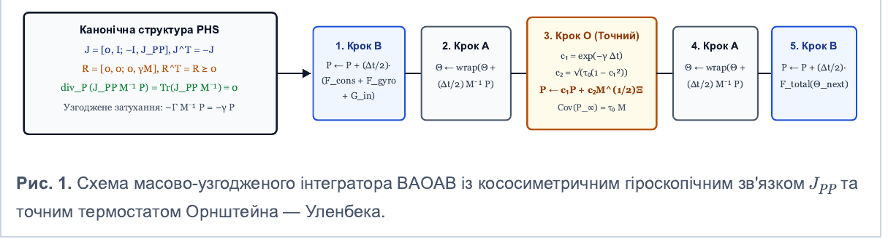
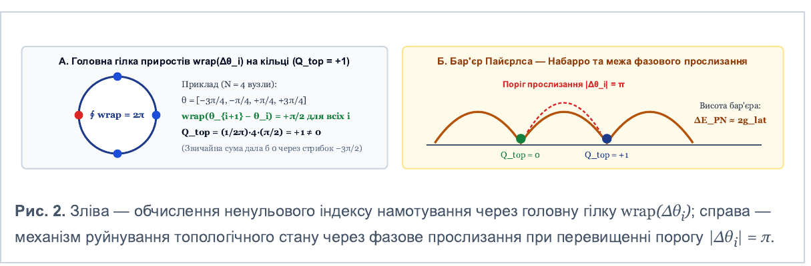

# Порт-гамільтонові та солітонні рекурентні резервуари на торі: формалізація та дизайн контрольного експерименту

> **Транскрипція.** Джерело: [`port-hamiltonian-soliton-reservoirs.pdf`](port-hamiltonian-soliton-reservoirs.pdf), 6 сторінок A4, Chromium/Skia, створено 2026-10-24 00:59 EEST. Оригінальна назва файлу: «Порт-гамільтонові та солітонні рекурентні резервуари — Математична специфікація та протокол експерименту.pdf». SHA-256: `0789a82d56a049e94ee0f838e7a5ef99fc6c74007ddd52b5a102c9758d6cf1b1`.
>
> Текст і формули перенесено без правок змісту. Позначка **[ОБРІЗАНО]** стоїть там, де PDF обрізав низ сторінки й текст утрачено. Чисельні перевірки тверджень лежать у [`check_starter.py`](check_starter.py), еталонний вивід — у [`check_starter.out`](check_starter.out). Примітки транскрипції в кінці файлу посилаються на ці перевірки (C1–C8).

*Дослідницький протокол та математична специфікація • Обчислювальна динаміка*

*Строга теорія фазових мереж Курамото — фон Мізеса, аналіз бар'єра Пайєрлса — Набарро у дискретній решітці Френкеля — Конторової та протокол верифікації проти класичних RNN*

## Предмет дослідження та епістемічні обмеження моделі

Цей документ визначає математично строгу архітектуру рекурентного динамічного резервуара з неперервним часом, у якому історія взаємодії кодується у поточному фізичному стані фазового многовиду. З моделі повністю виключено непідтверджені припущення про нескінченну ємність пам'яті, автоматичну глобальну оптимальність біфуркацій та апаратні оцінки за межею Ландауера. Натомість сформульовано фальсифіковану наукову гіпотезу та протокол прямого експериментального змагання трьох моделей рівної розмірності: чистого порт-гамільтонового резервуара (**Pure-PHS**), резервуара з топологічною решіткою Френкеля — Конторової (**Soliton-PHS**) та контрольної рекурентної мережі (**Control-GRU**).

## 1. Фазовий многовид, потенціал фон Мізеса та статус теореми Ліувілля

Розглянемо систему з $N$ осциляторних вузлів, кожен з яких має $d$ частотних каналів. Канонічний стан системи задається парою матриць $(\Theta, P)$ на кодотичному розшаруванні компактного тора $\mathcal{M} = T^{*}\mathbb{T}^{N\times d} \cong \mathbb{T}^{N\times d} \times \mathbb{R}^{N\times d}$, де $\Theta \in [-\pi, \pi)^{N\times d}$ — фазові кути, а $P \in \mathbb{R}^{N\times d}$ — спряжені імпульси. Інерційні властивості вузлів визначаються додатно визначеною діагональною матрицею мас $M = \mathrm{diag}(m_1, \dots, m_N)$. Повний Гамільтоніан консервативного ядра має вигляд $\mathcal{H}(\Theta, P) = \tfrac12 \mathrm{Tr}(P^{\top} M^{-1} P) + V_{att}(\Theta)$, де нелокальний потенціал уваги фон Мізеса задається логарифмічною сумою статистичної суми взаємодії:

$$
V_{att}(\Theta) = -\frac{1}{2\beta} \sum_{i=1}^{N} \ln \sum_{j=1}^{N} \exp\bigl(S_{ij}(\Theta)\bigr), \qquad
S_{ij}(\Theta) = \frac{\beta\kappa}{d} \sum_{k=1}^{d} \cos(\theta_{i,k} - \theta_{j,k}),
$$

$$
F_{att,i,k} = -\frac{\partial V_{att}}{\partial \theta_{i,k}} = -\frac{\kappa}{2d} \sum_{j=1}^{N} (A_{ij} + A_{ji}) \sin(\theta_{i,k} - \theta_{j,k}).
$$

Оскільки координата $\theta_{i,k}$ входить як у $i$-й доданок зовнішньої суми, так і в знаменники всіх $j$-х стохастичних ваг $A_{ij} = \exp(S_{ij}) / \sum_m \exp(S_{im})$, точний градієнт обов'язково містить симетризоване ядро $(A_{ij} + A_{ji})$. При цьому важливо строго розмежувати теорему Ліувілля та спектральний ранг матриці стану:

| Математична властивість | Що гарантується строго | Чого теорема НЕ гарантує (типова помилка) |
|---|---|---|
| Теорема Ліувілля ($\gamma = 0$) | Інваріантність фазового об'єму ансамблю траєкторій у $2Nd$-вимірному просторі ($\mathrm{div}\, X_{\mathcal{H}} = 0$) завдяки тотожності $\partial^2\mathcal{H}/\partial\Theta\partial P = \partial^2\mathcal{H}/\partial P\partial\Theta$. | **Не гарантує** збереження рангу одиночної матриці стану $Z_t = \exp(i\Theta_t)$: синхронізація фаз $\theta_i \to \theta_j$ може компенсуватися розтягненням імпульсів $P$. |
| **[ОБРІЗАНО]** | Подальші рядки таблиці, якщо вони були, у PDF не видно. | |

## 2. Непотенціальні приводи Сакагучі та гіроскопічна структура в PHS

Якщо до синусного зв'язку додати фазовий зсув Сакагучі $\alpha \neq 0$, утворене поле сил $F_{rot,i} = \sum_j C_{ij} \sin(\theta_j - \theta_i + \alpha)$ перестає бути потенціальним ($\partial F_{rot,i}/\partial\theta_j \neq \partial F_{rot,j}/\partial\theta_i$). Більше того, різниця між цим полем та градієнтом симетричного потенціалу $F_{diff} = F_{rot} - F_{att}$ **не є соленоїдальною** в сенсі розкладу Гельмгольца — Ходжа: її дивергенція на торі $\nabla_\Theta \cdot F_{diff} = \sum_{i,k} \partial F_{diff,i,k}/\partial\theta_{i,k}$ не дорівнює нулю (зокрема, вже для двох вузлів $N = 2$, $d = 1$ при $\alpha = \pi/2$ у точці $\theta_1 = \theta_2 = 0$ дивергенція становить $\nabla_\Theta \cdot F_{diff} \neq 0$). Тому будь-який позиційний привід із $\alpha \neq 0$ порушує симплектичність кроку за імпульсами.

Щоб ввести в систему строго бездивергентну циркуляцію між вузлами без руйнування гамільтонової геометрії, ми використовуємо канонічну **Порт-Гамільтонову Систему (PHS)** із кососиметричним гіроскопічним блоком $J_{PP} = -J_{PP}^{\top} \in \mathbb{R}^{N\times N}$ у структурній матриці взаємодії:

$$
\frac{d\Theta}{dt} = M^{-1} P, \qquad
\frac{dP}{dt} = -\nabla_\Theta \mathcal{H}(\Theta, P) + (J_{PP} - \Gamma) M^{-1} P + G_{in}(\Theta, x_t) + \Sigma_{noise}\, \xi(t)
$$

Гіроскопічна сила Лоренца — Коріоліса $F_{gyro}(P) = J_{PP} M^{-1} P$ тотожно ортогональна до вектора швидкості ($(M^{-1}P)^{\top} J_{PP} (M^{-1}P) \equiv 0$), не змінює повної енергії $\mathcal{H}$ і має строго нульову дивергенцію в фазовому просторі: $\nabla_P \cdot (J_{PP} M^{-1} P) = \mathrm{Tr}(J_{PP} M^{-1}) \equiv 0$, оскільки добуток кососиметричної матриці $J_{PP}$ на симетричну діагональну $M^{-1}$ має нульову головну діагональ.

## 3. Масово-узгоджена дисипація та стохастичний інтегратор BAOAB

Для повної узгодженості між неперервним рівнянням Ланжевена та дискретним кроком інтегрування матриця в'язкого демпфування задається пропорційною матриці мас: $\Gamma = \gamma M$, де скалярний коефіцієнт $\gamma > 0$ має розмірність оберненого часу ($\mathrm{c}^{-1}$). Тоді дисипативний член у рівнянні руху набуває вигляду $-\Gamma M^{-1} P = -\gamma P$ для кожного вузла незалежно від його маси $m_i$. Інтегрування на кроці $\Delta t$ виконується симетричним розщепленням **BAOAB**, де точний розв'язок лінійного стохастичного підкроку Орнштейна — Уленбека (**O-крок**) масштабується коренем із маси $M^{1/2}$, гарантуючи збереження стаціонарної коваріації Гіббса $\mathrm{Cov}(P_\infty) = \tau_0 M$.

**Рис. 1.** Схема масово-узгодженого інтегратора BAOAB із кососиметричним гіроскопічним зв'язком $J_{PP}$ та точним термостатом Орнштейна — Уленбека.

Вміст схеми:

- **Канонічна структура PHS:** $J = [0, I;\ -I, J_{PP}]$, $J^{\top} = -J$; $R = [0, 0;\ 0, \gamma M]$, $R^{\top} = R \succeq 0$; $\mathrm{div}_P(J_{PP} M^{-1} P) = \mathrm{Tr}(J_{PP} M^{-1}) \equiv 0$; узгоджене затухання $-\Gamma M^{-1} P = -\gamma P$.
- **1. Крок B:** $P \leftarrow P + (\Delta t/2)\,(F_{cons} + F_{gyro} + G_{in})$.
- **2. Крок A:** $\Theta \leftarrow \mathrm{wrap}(\Theta + (\Delta t/2) M^{-1} P)$.
- **3. Крок O (точний):** $c_1 = \exp(-\gamma \Delta t)$, $c_2 = \sqrt{\tau_0 (1 - c_1^2)}$, $P \leftarrow c_1 P + c_2 M^{1/2} \Xi$, $\mathrm{Cov}(P_\infty) = \tau_0 M$.
- **4. Крок A:** $\Theta \leftarrow \mathrm{wrap}(\Theta + (\Delta t/2) M^{-1} P)$.
- **5. Крок B:** $P \leftarrow P + (\Delta t/2)\, F_{total}(\Theta_{next})$.

## 4. Дискретний топологічний заряд на замкненому кільці

На замкненому кільці з періодичною індексацією вузлів ($\theta_{N+1,k} \equiv \theta_{1,k}$) звичайна алгебраїчна сума різниць $\sum_{i=1}^{N} (\theta_{i+1,k} - \theta_{i,k})$ телескопічно дорівнює нулю для будь-якої конфігурації. Щоб коректно визначити топологічне число намотування (winding number) на дискретній решітці без штучного розрізання кільця, вводиться оператор проєкції фазової різниці кожної ланки на головне значення кола $[-\pi, \pi)$:

$$
\mathrm{wrap}(\delta) = \bigl((\delta + \pi) \bmod 2\pi\bigr) - \pi \in [-\pi, \pi), \qquad
Q_{top,k}(\Theta) = \frac{1}{2\pi} \sum_{i=1}^{N} \mathrm{wrap}(\theta_{i+1,k} - \theta_{i,k}) \in \mathbb{Z}
$$

Оскільки для кожної ланки виконується тотожність $\mathrm{wrap}(\theta_{i+1,k} - \theta_{i,k}) = \theta_{i+1,k} - \theta_{i,k} + 2\pi n_{i,k}$, де $n_{i,k} \in \{-1, 0, +1\}$ фіксує перетин лінії розрізу $\pm\pi$, при підсумовуванні вздовж замкненого контуру неперервні координати $\theta_{i,k}$ взаємно скорочуються, і величина $Q_{top,k} = \sum_{i=1}^{N} n_{i,k}$ є **строго цілим числом**.

## 5. Решітка Френкеля — Конторової, бар'єр Пайєрлса — Набарро та межі пам'яті

У другій досліджуваній моделі (**Soliton-PHS**) до потенціалу уваги $V_{att}(\Theta)$ додається локальний потенціал пружного кільця Френкеля — Конторової (дискретне рівняння синус-Гордона) з періодичним піннінгом кратності $m$:

$$
V_{FK}(\Theta) = g_{lat} \sum_{i,k} \bigl(1 - \cos(\theta_{i+1,k} - \theta_{i,k})\bigr) + g_{pin} \sum_{i,k} \bigl(1 - \cos(m\, \theta_{i,k})\bigr).
$$

На відміну від неперервного рівняння синус-Гордона в вакуумі, дискретний дисипативний резервуар має три фундаментальні фізичні обмеження, які виключають безвтратне нескінченне зберігання історії:

1. **Поріг фазового прослизання (Phase Slip):** Гессіан енергії зв'язку сусідніх вузлів додатний лише при $\lvert\mathrm{wrap}(\theta_{i+1,k} - \theta_{i,k})\rvert < \pi/2$ (що обмежує число стійких намотувань нерівністю $\lvert Q_{top,k}\rvert < N/4$). Коли під дією зовнішнього сигналу або шуму розтягнення однієї ланки перетинає $\pm\pi$, система долає скінченний енергетичний бар'єр Пайєрлса — Набарро $\Delta E_{PN} \approx 2 g_{lat}$, і стається дискретне прослизання фази $Q_{top,k} \to Q_{top,k} \pm 1$.
2. **Неінтегровність та загасання бризерів:** Присутність демпфування $\gamma > 0$ та нелокального поля уваги $A_{ij}$ руйнує точну інтегровність: коливальні бризери релаксують за час $\mathcal{O}(1/\gamma)$, а зіткнення кінків стають непружними. Отже, решітка виступає **метастабільним атракторним резервуаром**, що підвищує завадостійкість на скінченному горизонті $T$, але має скінченну інформаційну ємність.

**Рис. 2.** Зліва — обчислення ненульового індексу намотування через головну гілку $\mathrm{wrap}(\Delta\theta_i)$; справа — механізм руйнування топологічного стану через фазове прослизання при перевищенні порогу $\lvert\Delta\theta_i\rvert = \pi$.

Вміст рисунка:

- **А. Головна гілка приростів $\mathrm{wrap}(\Delta\theta_i)$ на кільці ($Q_{top} = +1$).** Приклад для $N = 4$ вузлів: $\theta = [-3\pi/4, -\pi/4, +\pi/4, +3\pi/4]$; $\mathrm{wrap}(\theta_{i+1} - \theta_i) = +\pi/2$ для всіх $i$; $Q_{top} = (1/2\pi)\cdot 4 \cdot (\pi/2) = +1 \neq 0$; $\oint \mathrm{wrap} = 2\pi$. Звичайна сума дала б 0 через стрибок $-3\pi/2$.
- **Б. Бар'єр Пайєрлса — Набарро та межа фазового прослизання.** Поріг прослизання $\lvert\Delta\theta_i\rvert = \pi$; висота бар'єра $\Delta E_{PN} \approx 2 g_{lat}$; перехід між мінімумами $Q_{top} = 0$ і $Q_{top} = +1$.

## 6. Специфікація трьох конкуруючих архітектур

Щоб емпірично перевірити, чи дає фізично структурована солітонна пам'ять вимірювану перевагу над звичайним фазовим резервуаром та евклідовою рекурентною мережею, ми фіксуємо три моделі з **однаковою розмірністю динамічного стану** $D_{state} = 2Nd$ та ідентичним протоколом оптимізації:

| Характеристика | Модель 1: Pure-PHS (чистий порт-гамільтонів резервуар) | Модель 2: Soliton-PHS (PHS + решітка Френкеля — Конторової) | Модель 3: Control-GRU (контрольна евклідова RNN) |
|---|---|---|---|
| **Простір станів** | Кодотичний тор $(\Theta_t, P_t) \in \mathbb{T}^{N\times d} \times \mathbb{R}^{N\times d}$ | Кодотичний тор $(\Theta_t, P_t) \in \mathbb{T}^{N\times d} \times \mathbb{R}^{N\times d}$ | Евклідів простір $h_t \in \mathbb{R}^{2Nd}$ |
| **Нелокальна взаємодія** | Симетризована сила фон Мізеса $F_{att}$ + гіроскопічна $J_{PP} M^{-1} P$ | Симетризована сила фон Мізеса $F_{att}$ + гіроскопічна $J_{PP} M^{-1} P$ | Матричне множення $W_{hh} h_{t-1}$ з вентилями скидання та оновлення |
| **Локальна топологічна пам'ять** | **Відсутня** ($g_{lat} = 0$, $g_{pin} = 0$); вузли зв'язані лише через глобальне поле $A_{ij}$ | **Активна:** дискретний лапласіан синусів $g_{lat}$ та мульти-ямний піннінг $g_{pin}$ | Евклідова інтерполяція $h_t = (1 - z_t) \odot h_{t-1} + z_t \odot \tilde h_t$ |
| **Оператор переходу в часі** | $K$ підкроків інтегратора BAOAB із демпфуванням $\gamma$ на один токен | $K$ підкроків інтегратора BAOAB із демпфуванням $\gamma$ на один токен | Один дискретний крок нелінійного відображення GRU |
| **Зчитування стану (Readout)** | Лінійний проєктор на вкладенні Кліффорда $[\cos\Theta_t, \sin\Theta_t, P_t]\, W_{out}$ | Лінійний проєктор на вкладенні Кліффорда $[\cos\Theta_t, \sin\Theta_t, P_t]\, W_{out}$ | Лінійний проєктор $h_t W_{out} + b_{out}$ |
| **Очікуваний механізм деградації** | Швидке затухання слідів за час $\sim 2/\gamma$ та синфазне стягнення рангу | Дискретні фазові прослизання при перевищенні бар'єра $\Delta E_{PN}$ | Зникання градієнтів або розмивання стану адитивним шумом |

## 7. Чому біфуркація не є розв'язувачем без вирівнювання градієнтом задачі

Фундаментальна вада суто фізичних моделей осциляторного виведення полягає в ототожненні *фазової синхронізації* з *правильністю розв'язку*. Класичний поріг Курамото $\kappa_c = 2 / (\pi g(0))$ виводиться для безінерційних осциляторів першого порядку з однорідним зв'язком «кожен з кожним» і не описує інерційну порт-гамільтонову систему з піннінгом. Але головне інше: навіть коли система стабільно проходить біфуркацію і фіксується в глибокому мінімумі фізичного потенціалу $V(\Theta)$, цей атрактор є лише внутрішньо узгодженим станом динаміки, який без спеціального навчання ніяк не корелює з істинною відповіддю задачі.

> **Зв'язування динамічного функціонала з функцією втрат через BPTT.** Щоб атрактори потенціалу $V_{total}(\Theta; \varphi)$ відповідали правильним логічним станам, усі параметри гамільтоніана $\varphi = \{\kappa, g_{lat}, g_{pin}, M, J_{PP}\}$, параметри вхідного порту $G_{in}(x_t)$ та матриця зчитування $W_{out}$ оптимізуються методом наскрізного зворотного поширення похибки в часі (**Backpropagation Through Time, BPTT**) безпосередньо крізь диференційовний граф кроків BAOAB. Мінімізація перехресної ентропії $\mathcal{L}_{CE}(\hat y_T, y_{true})$ деформує рельєф потенціалу так, щоб басейни притягання фізичної динаміки збігалися з класами еквівалентності цільового алгоритму.

## 8. Алгоритмічна специфікація ядра (PyTorch-протокол)

Нижче наведено повну покрокову специфікацію обчислювального ядра **PortHamiltonianCore**, яка об'єднує обидві фізичні моделі (при $g_{lat} = g_{pin} = 0$ отримуємо **Pure-PHS**, при $g_{lat} > 0$, $g_{pin} > 0$ — **Soliton-PHS**). Усі операції є повністю векторизованими по пакету даних розміру $B$ і підтримують автоматичне диференціювання у PyTorch.

**Алгоритм 1: Диференційовний крок ітерації та діагностики PortHamiltonianCore (Моделі 1 та 2)**

**Вхід:** послідовність індексів токенів $x_{1:T} \in \{0, \dots, V-1\}^{B\times T}$; кількість вузлів $N$; розмірність фази $d$; крок $\Delta t$; підкроки $S$; демпфування $\gamma$; температура шуму $\tau_0$; прапорець решітки $\lambda_{FK} \in \{0, 1\}$.

**Ініціалізація:** $\Theta_0 \leftarrow 0 \in \mathbb{R}^{B\times N\times d}$, $P_0 \leftarrow 0 \in \mathbb{R}^{B\times N\times d}$; додатні маси $M = \exp(w_M) \in \mathbb{R}^{1\times N\times 1}$; кососиметрична матриця Лоренца $J_{PP} = W_{skew} - W_{skew}^{\top} \in \mathbb{R}^{N\times N}$; коефіцієнти О—У: $\delta t = \Delta t / S$, $c_1 = \exp(-\gamma\, \delta t)$, $c_2 = \sqrt{\tau_0 (1 - c_1^2)}$.

**Цикл за дискретним часом токена $t = 1, \dots, T$:**

1. **Вхідний порт токенів:** обчислити цільову фазу $\Phi_{ext} = \mathrm{wrap}(E_\varphi(x_t)) \in [-\pi, \pi)^{B\times N\times d}$ та амплітуду накачки $U_{drive} = \sigma(E_u(x_t)) \in (0, u_{max})^{B\times N\times d}$.
2. **Підцикл фізичного інтегрування BAOAB для $s = 1, \dots, S$:**
   1. *Функція консервативної сили $F_{cons}(\Theta)$:*
      - Попарні різниці $\Delta_{ij,k} = \theta_{i,k} - \theta_{j,k}$; косинусна близькість $C_{ij} = (1/d) \sum_{k=1}^{d} \cos(\Delta_{ij,k})$.
      - Стохастична матриця $A_{ij} = \mathrm{softmax}_j(\kappa C_{ij})$; симетризація $A^{sym}_{ij} = \tfrac12 (A_{ij} + A_{ji})$.
      - Сила уваги: $F_{att,i,k} = -(\kappa / d) \sum_{j=1}^{N} A^{sym}_{ij} \sin(\Delta_{ij,k})$; сила входу: $F_{ext,i,k} = -U_{drive,i,k} \sin(\theta_{i,k} - \Phi_{ext,i,k})$.
      - Якщо $\lambda_{FK} = 1$ (режим Soliton-PHS): додати дискретний лапласіан синусів уздовж кільця $F_{FK,i,k} = g_{lat} [\sin(\theta_{i+1,k} - \theta_{i,k}) - \sin(\theta_{i,k} - \theta_{i-1,k})] - m\, g_{pin} \sin(m\, \theta_{i,k})$.
   2. *Крок B (1/2):* $P \leftarrow P + (\delta t / 2)\, [F_{cons}(\Theta) + J_{PP} (M^{-1} P)]$.
   3. *Крок A (1/2):* $\Theta \leftarrow \mathrm{wrap}(\Theta + (\delta t / 2) M^{-1} P)$.
   4. *Крок O (термостат):* згенерувати $\Xi \sim \mathcal{N}(0, I)$; оновити $P \leftarrow c_1 P + c_2 M^{1/2} \Xi$.
   5. *Крок A (2/2):* $\Theta \leftarrow \mathrm{wrap}(\Theta + (\delta t / 2) M^{-1} P)$.
   6. *Крок B (2/2):* переобчислити $F_{cons}(\Theta)$ у новій точці; оновити $P \leftarrow P + (\delta t / 2)\, [F_{cons}(\Theta) + J_{PP} (M^{-1} P)]$.
3. **Топологічний моніторинг:** обчислити $Q_{top,t,k} = (1/2\pi) \sum_{i=1}^{N} \mathrm{wrap}(\theta_{i+1,k} - \theta_{i,k}) \in \mathbb{Z}$ та зафіксувати подію фазового прослизання, якщо $\lvert Q_{top,t,k} - Q_{top,t-1,k}\rvert \geq 1$.
4. **Зчитування логітів:** сформувати вектор Кліффорда $z_t = [\cos(\Theta), \sin(\Theta), P] \in \mathbb{R}^{B\times 3Nd}$ та обчислити $L_t = z_t W_{out} + b_{out}$.

> **Інженерні контрольні тести (unit tests) перед запуском навчання.** Перед початком тренування кожна реалізація проходить три обов'язкові чисельні перевірки: (1) **Тест консервативності:** при $\gamma = 0$, $\tau_0 = 0$, $U_{drive} = \mathrm{const}$ коливання повної енергії $\lvert\mathcal{H}_t - \mathcal{H}_0\rvert$ на $10^3$ кроках має масштабуватися як $\mathcal{O}(\delta t^2)$ навіть при ненульовій гіроскопічній матриці $J_{PP} \neq 0$; (2) **Тест Гіббса:** при $F_{cons} = 0$, $\gamma > 0$ вибіркова дисперсія імпульсів $P_i$ має збігатися до $\tau_0 m_i$ з похибкою менше 2%; (3) **Тест цілочисельності заряду:** для будь-якого випадкового тензора $\Theta \in [-\pi, \pi)^{B\times N\times d}$ відхилення $\lvert Q_{top} - \mathrm{round}(Q_{top})\rvert$ не повинно перевищувати машинної **[ОБРІЗАНО]** (найімовірніше, «точності»; решта блоку не видна).

## 9. Експериментальні бенчмарки: перевірка пам'яті та логічних переходів

Оцінювання трьох моделей (**Pure-PHS**, **Soliton-PHS**, **Control-GRU**) проводиться на двох синтетичних задачах зі змінною довжиною послідовності $T \in \{16, 32, 64, 128\}$ та керованим рівнем теплового/канального шуму $\sigma_{noise} = \sqrt{\tau_0} \in [0.0, 0.35]$:

1. **Задача А — Вибіркове утримання крізь потік дистракторів (Selective Copy-Recall under Noise):** На перших двох кроках ($t = 0, 1$) мережа отримує інформаційний маркер $y \in \{1, \dots, V-1\}$. Протягом наступних $T - 3$ кроків подається фоновий потік нульових токенів, у який з імовірністю $p_{dist} = 0.25$ вкраплюються випадкові символи-дистрактори, що намагаються збити фазову траєкторію з початкового басейну. На фінальному кроці $t = T - 1$ мережа повинна класифікувати початковий символ $y$. Задача безпосередньо вимірює здатність бар'єра Пайєрлса — Набарро утримувати записану конфігурацію проти інтерференції.
2. **Задача Б — Багатоетапний трекінг стану скінченного автомата (Modular FSM Parity & Inversion):** На кожному кроці $t$ подається команда $x_t \in \{0, 1, 2, 3\}$. При $x_t \in \{0, 1, 2\}$ внутрішній стан автомата оновлюється за правилом модульної арифметики $S_t = (S_{t-1} + x_t) \bmod M$, а при $x_t = 3$ виконується некомутативна операція інверсії $S_t = (M - S_{t-1}) \bmod M$. Ця задача не може бути розв'язана простим усередненням чи статичним утриманням одного солітона — вона вимагає точного послідовного перемикання між атракторами на кожному кроці.

## 10. Матриця вимірюваних метрик та критерії фальсифікації

Для виключення суб'єктивної інтерпретації результати прогонів фіксуються за п'ятьма кількісними показниками, усередненими за 5 незалежними випадковими ініціалізаціями (seeds):

| Метрика | Формальне визначення | Що саме діагностує в експерименті |
|---|---|---|
| **Точність на горизонті** $Acc(T)$ | Частка правильних передбачень $\mathbb{P}(\hat y_T = y_{true})$ на тестовій вибірці як функція довжини $T$. | Ефективна глибина часової пам'яті резервуара та здатність виконувати довгі ланцюжки переходів FSM. |
| **Поріг шумового зриву** $\sigma_{crit}$ | Максимальна амплітуда шуму термостата $\sqrt{\tau_0}$, за якої точність утримання перевищує 80%. | Наявність або відсутність енергетичного захисту топологічних станів порівняно з гладким потенціалом. |
| **Частота прослизань** $R_{slip}$ | Середня кількість стрибків $\lvert\Delta Q_{top}\rvert \geq 1$ за один прохід послідовності довжини $T$. | Пряма діагностика руйнування солітонної пам'яті: ріст $R_{slip}$ на ділянці утримання має корелювати з падінням $Acc(T)$. |
| **Спектральний ранг** $\mathrm{erank}(Z_T)$ | $\exp(-\sum_r p_r \ln p_r)$ для сингулярних чисел матриці $[\cos\Theta_T, \sin\Theta_T] \in \mathbb{R}^{N\times 2d}$. | Перевірка того, чи запобігає решітка Френкеля — Конторової синфазному схлопуванню вузлів у вектор рангу 1. |
| **Обчислювальна ціна** $C_{step}$ | Час виконання одного кроку (мс/токен) та кількість операцій з плаваючою комою ($O(N^2 d)$ проти $O(N^2 d^2)$). | Реальна ціна чисельного інтегрування BAOAB порівняно зі стандартним матричним кроком GRU. |

> **Чіткий критерій підтвердження або спростування гіпотези.** **Умова підтвердження:** Гіпотеза про цінність фізично структурованої солітонної пам'яті вважається підтвердженою, якщо **Soliton-PHS** демонструє статистично значуще вищий поріг стійкості до шуму $\sigma_{crit}$ та повільніше падіння точності $Acc(T)$ зі зростанням $T$ на Задачі А **[ОБРІЗАНО]**. Під обрізом видно лише фрагменти рядка: «і … ( … і … і … ) і». Решта умови підтвердження та вся умова спростування втрачені.

## Примітки транскрипції

Ці примітки не належать до тексту PDF. Вони фіксують, що показала чисельна перевірка ([`check_starter.out`](check_starter.out), 12/12 PASS) і де стартер неповний.

1. **§1, сила уваги (C1).** Формула $F_{att}$ із симетризованим ядром збігається з $-\nabla V_{att}$ до $6\cdot10^{-10}$. Варіант без симетризації відхиляється на $3\cdot10^{-2}$. У §1 параметр $\beta$ довільний, в Алгоритмі 1 $A = \mathrm{softmax}(\kappa C)$, тобто там неявно $\beta = 1$.
2. **§5 і Алгоритм 1, сила Френкеля — Конторової (C2).** Знаки правильні, похибка $2\cdot10^{-9}$.
3. **§2, гіроскопічні тотожності (C3).** Тотожності правильні в неперервному часі.
4. **Алгоритм 1, кроки B (C4a–C4d, C5).** Явне додавання $J_{PP} M^{-1} P$ у кроці B не зберігає енергії. Півкрок $P \leftarrow (I + \tfrac{\delta t}{2} J_{PP} M^{-1}) P$ має норму $\sqrt{1 + (\delta t\, \lambda_{max}/2)^2} > 1$, тож імпульси розгойдуються геометрично. За довгого прогону похибка енергії сягає $10^{58}$, і передбачений множник $6\cdot10^{58}$ це пояснює. Тест консервативності з PDF (фіксовані $10^3$ кроків) дефекту не бачить: усі три варіанти інтегратора дають порядок $\geq 2$. Тест Гіббса з PDF не бачить його при $J_{PP} = 0$, а при $J_{PP} \neq 0$ зміщення дисперсії сягає 4–17%. Точний поворот (Кейлі) або точний кінетичний потік дають порядок 2, обмежену похибку на довгому прогоні та зміщення дисперсії < 0.1%.
5. **§4, заряд (C6, C6b).** У float32 $Q_{top}$ ціле до $10^{-6}$, $n_{i,k} \in \{-1, 0, 1\}$. Коли ланка дорівнює рівно $\pm\pi$, знак $Q$ визначає конвенція півінтервалу $[-\pi, \pi)$, а не геометрія.
6. **Рис. 2 і §5 (C7).** Приклад $Q_{top} = +1$ при $N = 4$ має всі ланки рівно $\pi/2$. Отже, він лежить на межі стійкості $\lvert Q\rvert = N/4$, а не всередині $\lvert Q\rvert < N/4$.
7. **§2, Сакагучі (C8).** Твердження $\nabla_\Theta \cdot F_{diff} \neq 0$ у вказаній точці правильне, але вся дивергенція йде від консервативної $F_{att}$, а не від $F_{rot}$: $\nabla \cdot F_{rot}(0) = 0$. Крок $P \leftarrow P + h F(\Theta)$ зберігає фазовий об'єм для будь-якого $F(\Theta)$. Симплектичність порушує несиметричний якобіан $F_{rot}$, а не дивергенція. У жодній із трьох моделей $\alpha$ не використовується.
8. **Не перевірено.** Назва «бар'єр Пайєрлса — Набарро» для $\Delta E_{PN} \approx 2 g_{lat}$ означає висоту енергії однієї ланки в $\pm\pi$. Класичний бар'єр Пайєрлса — Набарро — це бар'єр переміщення кінка на одну комірку. Реальний бар'єр прослизання в системі з увагою та піннінгом треба виміряти, а не брати з цієї оцінки.
9. **§5, перелік обмежень.** Текст обіцяє три фундаментальні обмеження, а в PDF їх два. Це не обріз сторінки: після другого пункту йде рисунок.
10. **Пропущені параметри.** У PDF не задано $N$, $d$, $V$, $S$ (у таблиці §6 вона ж $K$), $\Delta t$, $\gamma$, $u_{max}$, $m$, модуль автомата, бюджет навчання, оптимізатор, спосіб подачі шуму в Control-GRU, розмір тестової вибірки та статистичний тест. Літерою $M$ позначено і матрицю мас, і модуль автомата Задачі Б.
